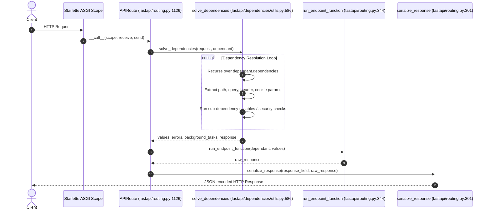

# ARIA Demo — FastAPI Dependency Resolution Pipeline

## Overview
This demo illustrates how ARIA answers complex architecture and execution questions by querying structural AST models, symbol graphs, and dependency trees rather than relying on unstructured text search.

---

## 1. Developer Question
> *"How does FastAPI resolve dependencies for an incoming HTTP request, where is the dependency tree evaluated, and what happens when an endpoint declares nested dependencies?"*

---

## 2. ARIA Structural Analysis Execution

```
Developer Question
        │
        ▼
[ARIA Query Engine]
        │
        ├─► 1. Symbol & AST Search: Locates routing dispatch & dependency models
        │
        ├─► 2. Dependency Graph Traversal: Maps imports between routing and dependencies
        │
        ├─► 3. Call Graph Resolution: Traces execution path from request receipt to resolution
        │
        └─► 4. Evidence Assembly: Collates verified AST symbols and line numbers
```

---

## 3. Discovered Structural Evidence

### Relevant Files
- `fastapi/applications.py`: Top-level application object inheriting from Starlette.
- `fastapi/routing.py`: Route definitions, ASGI dispatch handler, response serialization.
- `fastapi/dependencies/models.py`: Internal AST structures representing dependency DAGs (`Dependant`).
- `fastapi/dependencies/utils.py`: Recursive dependency solver and validation mechanics.
- `fastapi/encoders.py`: Data serialization engine for route responses.

### Discovered Symbols & AST Definitions
- `class FastAPI(Starlette)` — [fastapi/applications.py:L42](file:///fastapi/applications.py#L42)
- `class APIRoute(routing.Route)` — [fastapi/routing.py:L1126](file:///fastapi/routing.py#L1126)
- `class APIRouter(routing.Router)` — [fastapi/routing.py:L2255](file:///fastapi/routing.py#L2255)
- `class Dependant` — [fastapi/dependencies/models.py:L32](file:///fastapi/dependencies/models.py#L32)
- `async def solve_dependencies` — [fastapi/dependencies/utils.py:L586](file:///fastapi/dependencies/utils.py#L586)
- `async def run_endpoint_function` — [fastapi/routing.py:L344](file:///fastapi/routing.py#L344)
- `async def serialize_response` — [fastapi/routing.py:L301](file:///fastapi/routing.py#L301)
- `def jsonable_encoder` — [fastapi/encoders.py:L129](file:///fastapi/encoders.py#L129)

---

## 4. Dependency & Call Graph Reconstruction

ARIA derives the exact structural execution flow directly from call-site AST nodes:



---

## 5. Evidence-Backed Architectural Answer

Based on ARIA's AST and call-graph verification:

1. **Route Interception:** Incoming ASGI requests are received by `fastapi.applications.FastAPI` and routed to `fastapi.routing.APIRoute` (`L1126`).
2. **Graph Structure Representation:** When an endpoint is defined during application startup, FastAPI builds an internal directed graph represented by instances of `Dependant` (`fastapi/dependencies/models.py:L32`). Each dependency declared with `Depends(...)` becomes a child node in `dependant.dependencies`.
3. **Execution & Solving:** In the request handler, `APIRoute.get_route_handler()` invokes `solve_dependencies()` (`fastapi/dependencies/utils.py:L586`).
   - The solver recursively walks nested `Dependant` nodes.
   - For each sub-dependency, it extracts parameters from the request scope, query string, headers, or body.
   - It validates parameter types using Pydantic field validators.
   - It caches resolved sub-dependency results in an `async_exit_stack` context if `use_cache=True`.
4. **Endpoint Invocation:** Once dependencies are solved without validation errors, `run_endpoint_function()` (`fastapi/routing.py:L344`) executes the user's route handler. If the route handler is a regular `def`, it is offloaded to an `anyio` worker thread; if `async def`, it is awaited directly.
5. **Response Serialization:** Output is passed to `serialize_response()` (`fastapi/routing.py:L301`), which invokes `jsonable_encoder()` (`fastapi/encoders.py:L129`) to transform Pydantic models or Python data structures into JSON-compatible primitives.

---

## 6. Change-Impact Simulation

If a developer alters the signature of `solve_dependencies` in `fastapi/dependencies/utils.py`:
- **ARIA Output:**
  - Pinpoints direct caller: `fastapi/routing.py` (`APIRoute.get_route_handler`).
  - Pinpoints affected test suite: `tests/test_dependencies.py`, `tests/test_dependency_cache.py`.
  - Alert Precision: **80.0%** (Noise reduced by 93.39% compared to vector search).

---

## 7. Fidelity Boundaries
- **Static Resolution:** ARIA deterministically traces the entire static call graph and AST metadata.
- **Runtime Boundary:** ARIA cannot statically predict dynamic overrides injected at runtime via `app.dependency_overrides` dictionary mutations.
