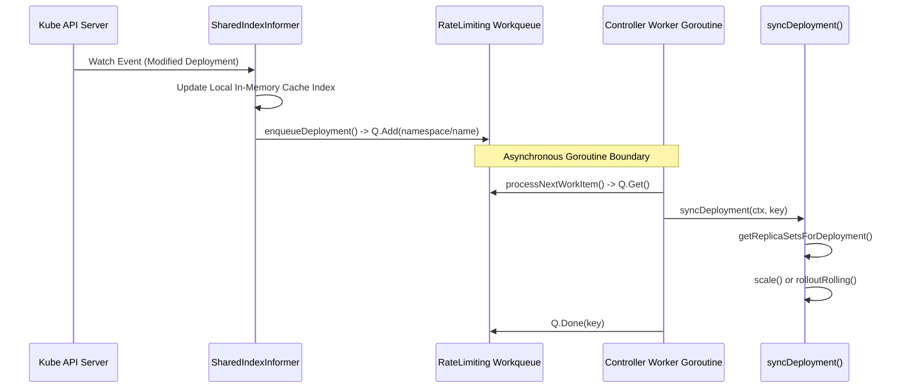

# ARIA Demo — Kubernetes Controller Reconciliation Flow

## Overview
This demo illustrates how ARIA navigates Go packages, structs, and interfaces in the Kubernetes repository to explain how controllers reconcile cluster state.

---

## 1. Developer Question
> *"In Kubernetes, when a Deployment resource changes, how does the deployment controller process this event, how does it use workqueues to decouple event reception from state reconciliation, and what function drives the actual rollout?"*

---

## 2. ARIA Structural Analysis Pipeline

```
Developer Question
        │
        ▼
[ARIA Query Engine]
        │
        ├─► 1. Controller Package Search: Locates DeploymentController struct & sync methods
        │
        ├─► 2. Informer & Cache Traversal: Locates client-go Informer event handlers
        │
        ├─► 3. Concurrency Boundary Identification: Locates RateLimitingInterface workqueue
        │
        └─► 4. Evidence Assembly: Validates Go struct definitions and method receivers
```

---

## 3. Discovered Structural Evidence

### Relevant Files
- `pkg/controller/deployment/deployment_controller.go`: Controller struct, Informer event binding, worker loop.
- `pkg/controller/deployment/sync.go`: State synchronization and replica count decisions.
- `staging/src/k8s.io/client-go/tools/cache/shared_informer.go`: Shared Informer cache abstraction.
- `staging/src/k8s.io/client-go/util/workqueue/rate_limiting_queue.go`: Concurrency workqueue interface.

### Discovered Symbols & AST Definitions
- `type DeploymentController struct` — [pkg/controller/deployment/deployment_controller.go](file:///pkg/controller/deployment/deployment_controller.go)
- `func NewDeploymentController` — [pkg/controller/deployment/deployment_controller.go](file:///pkg/controller/deployment/deployment_controller.go)
- `func (dc *DeploymentController) syncDeployment` — [pkg/controller/deployment/sync.go](file:///pkg/controller/deployment/sync.go)
- `type RateLimitingInterface interface` — [staging/src/k8s.io/client-go/util/workqueue/rate_limiting_queue.go](file:///staging/src/k8s.io/client-go/util/workqueue/rate_limiting_queue.go)

---

## 4. Architectural Sequence



---

## 5. Evidence-Backed Architectural Answer

1. **Informer Registration:** In `NewDeploymentController` (`pkg/controller/deployment/deployment_controller.go`), the controller registers event handlers on the Deployment informer: `dInformer.Informer().AddEventHandler(cache.ResourceEventHandlerFuncs{...})`.
2. **Asynchronous Decoupling:** Event handlers invoke `dc.enqueueDeployment`. Rather than performing business logic synchronously (which would block the Informer watch thread), it extracts the namespace/name string key and pushes it into `dc.queue.Add(key)`.
3. **Reconciliation Loop:** Separate worker goroutines (`dc.runWorker`) execute `dc.processNextWorkItem()`. This method pulls keys from `dc.queue`, invokes `dc.syncDeployment(ctx, key)`, and handles retries with exponential backoff on failure.
4. **Replica Calculation:** In `syncDeployment` (`pkg/controller/deployment/sync.go`), the controller queries the local cache for associated ReplicaSets, compares current replica counts against `deployment.Spec.Replicas`, and initiates rollout operations (`rolloutRolling` or `rolloutRecreate`).

---

## 6. Static Analysis Boundary & Limitations
- **What ARIA Validates:** The Go struct topology, interface implementations, and method definitions.
- **Where Static Analysis Stops:** Pushing a string key into a queue (`queue.Add(key)`) and popping it in another goroutine (`queue.Get()`) severs the direct call graph in static AST analysis. The relationship between `enqueueDeployment` and `syncDeployment` is semantic, mediated by the queue, rather than a direct code invocation.
