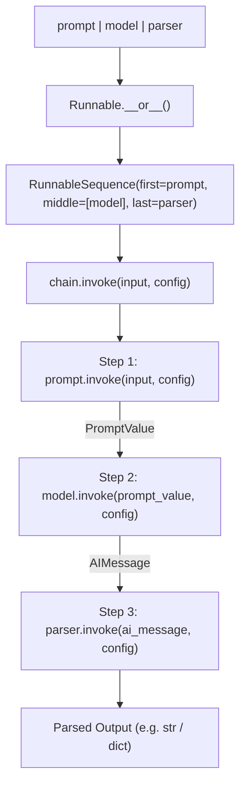

# ARIA Demo — LangChain Runnable Execution & LCEL Pipeline

## Overview
This demo illustrates how ARIA inspects operator overloading, protocol inheritance, and callback propagation across the LangChain Expression Language (LCEL) framework.

---

## 1. Developer Question
> *"When chaining runnables together with `chain = prompt | model | parser`, what internal classes are created, and how does `chain.invoke({"topic": "agents"})` pass parameters and context through each step?"*

---

## 2. ARIA Structural Analysis Pipeline

```
Developer Question
        │
        ▼
[ARIA Query Engine]
        │
        ├─► 1. Operator Overload Search: Locates __or__ and __ror__ in Runnable protocols
        │
        ├─► 2. Class Hierarchy Traversal: Traces Runnable -> RunnableSequence -> BaseChatModel
        │
        ├─► 3. Execution Graph Analysis: Traces synchronous vs asynchronous invoke cycles
        │
        └─► 4. Evidence Assembly: Validates AST symbol definitions in langchain_core
```

---

## 3. Discovered Structural Evidence

### Relevant Files
- `libs/core/langchain_core/runnables/base.py`: Core protocol definitions (`Runnable`, `RunnableSequence`, `RunnableParallel`).
- `libs/core/langchain_core/runnables/config.py`: Runtime configuration and callback handling (`RunnableConfig`).
- `libs/core/langchain_core/prompts/base.py`: Base prompt formatters.
- `libs/core/langchain_core/language_models/chat_models.py`: Chat model protocol wrappers.
- `libs/core/langchain_core/output_parsers/base.py`: Output parser abstractions.

### Discovered Symbols & AST Definitions
- `class Runnable` — [langchain_core/runnables/base.py](file:///libs/core/langchain_core/runnables/base.py)
- `class RunnableSequence` — [langchain_core/runnables/base.py](file:///libs/core/langchain_core/runnables/base.py)
- `def __or__` — [langchain_core/runnables/base.py](file:///libs/core/langchain_core/runnables/base.py)
- `def invoke` — [langchain_core/runnables/base.py](file:///libs/core/langchain_core/runnables/base.py)
- `class RunnableConfig` — [langchain_core/runnables/config.py](file:///libs/core/langchain_core/runnables/config.py)

---

## 4. Execution Call Graph



---

## 5. Evidence-Backed Architectural Answer

1. **Pipeline Construction:** When the `|` operator is evaluated between two `Runnable` instances, Python invokes `Runnable.__or__`. This AST method checks if the caller or argument is already a `RunnableSequence`. If not, it instantiates a new `RunnableSequence(first=self, last=other)`.
2. **Context & Execution Loop:** When `chain.invoke(input)` is called:
   - `RunnableSequence.invoke` initializes a `RunnableConfig` containing runtime options (tags, metadata, recursion limits, and callbacks).
   - It sequentially iterates through its list of steps.
   - For each step, it passes the accumulated input along with the merged configuration object to `step.invoke()`.
   - Callbacks (`CallbackManagerForChainRun`) are triggered at each step transition.

---

## 6. Static Analysis Boundary & Limitations
- **What ARIA Validates:** The static composition of the pipeline, class inheritance of all runnables, and AST operator methods.
- **Where Static Analysis Stops:** If an agent dynamically instantiates a model via runtime string selection (e.g. `init_chat_model(os.getenv("MODEL"))`) or binds dynamically registered tools, static AST analysis cannot know which downstream API client is called at runtime.
