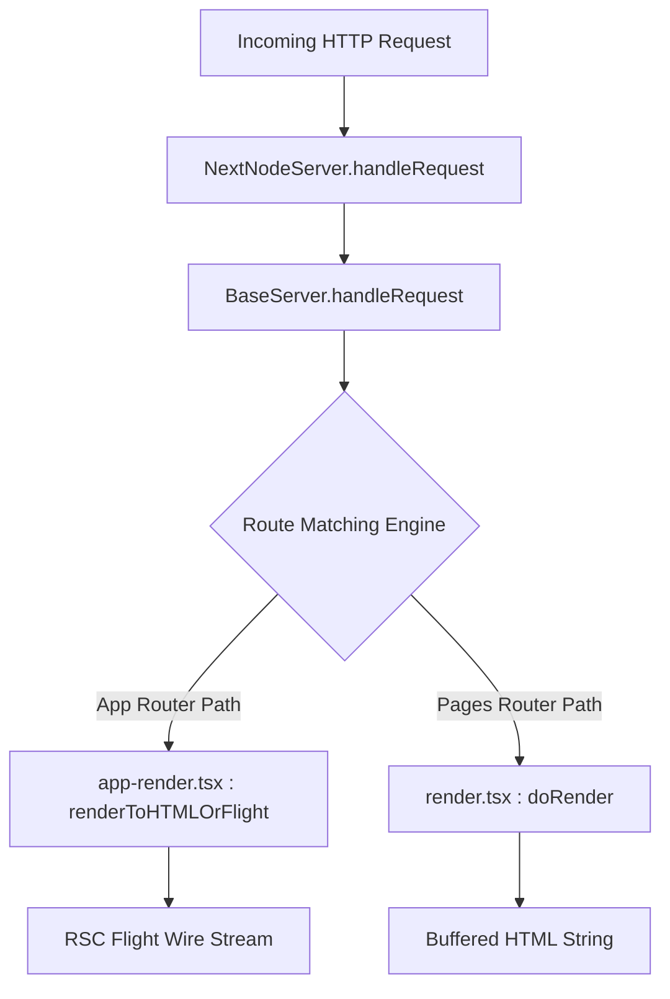

# ARIA Demo — Next.js Request Flow & Server Core

## Overview
This demo illustrates how ARIA navigates TypeScript class hierarchies, routing abstractions, and React Server Component (RSC) rendering lifecycles in the Next.js monorepo.

---

## 1. Developer Question
> *"When an HTTP request enters Next.js, what is the core server dispatch chain, where are React Server Components (RSC) rendered into the Flight payload stream, and how does the server distinguish App Router from Pages Router requests?"*

---

## 2. ARIA Structural Analysis Pipeline

```
Developer Question
        │
        ▼
[ARIA Query Engine]
        │
        ├─► 1. Server Core Search: Locates BaseServer and NextNodeServer implementations
        │
        ├─► 2. Hierarchy Resolution: BaseServer -> NextNodeServer -> NextServer
        │
        ├─► 3. Route Branching: Traces route matching against manifests
        │
        └─► 4. Evidence Assembly: Maps server rendering pipelines in packages/next
```

---

## 3. Discovered Structural Evidence

### Relevant Files
- `packages/next/src/server/base-server.ts`: Abstract base server handling request lifecycle, routing, and headers.
- `packages/next/src/server/next-server.ts`: Concrete Node.js production server implementation.
- `packages/next/src/server/app-render/app-render.tsx`: Core App Router server rendering pipeline.
- `packages/next/src/server/render.tsx`: Pages Router server-side rendering pipeline.

### Discovered Symbols & AST Definitions
- `class BaseServer` — [packages/next/src/server/base-server.ts](file:///packages/next/src/server/base-server.ts)
- `class NextNodeServer` — [packages/next/src/server/next-server.ts](file:///packages/next/src/server/next-server.ts)
- `function renderToHTMLOrFlight` — [packages/next/src/server/app-render/app-render.tsx](file:///packages/next/src/server/app-render/app-render.tsx)
- `function doRender` — [packages/next/src/server/render.tsx](file:///packages/next/src/server/render.tsx)

---

## 4. Server Execution Hierarchy



---

## 5. Evidence-Backed Architectural Answer

1. **Central Server Bottleneck:** All Node.js HTTP requests are processed through `NextNodeServer` (`packages/next/src/server/next-server.ts`), which inherits from `BaseServer` (`packages/next/src/server/base-server.ts`).
2. **Route Match Engine:** Inside `BaseServer.handleRequest()`, the URL is evaluated against routes loaded from compile-time manifest files (`AppPathRoutesManifest` and `PagesManifest`).
3. **Execution Branch:**
   - For App Router routes (`/app`), the server invokes `renderToHTMLOrFlight()` (`packages/next/src/server/app-render/app-render.tsx`). This invokes the React Server Components compiler stream, outputting a serialized React Flight format (`text/x-component`) or rendering HTML shells.
   - For legacy Pages Router routes (`/pages`), it invokes `doRender()` in `packages/next/src/server/render.tsx`, executing `getServerSideProps` or `getStaticProps` before rendering React DOM trees.

---

## 6. Static Analysis Boundary & Limitations
- **What ARIA Validates:** The TypeScript class hierarchy, server request lifecycle functions, and AST branches.
- **Where Static Analysis Stops:** Next.js uses compile-time generated JSON manifests (`app-paths-manifest.json`, `middleware-manifest.json`) generated by webpack/Turbopack. Because these manifests do not exist in source control, static AST inspection cannot trace runtime route mappings without simulating or observing the build step.
