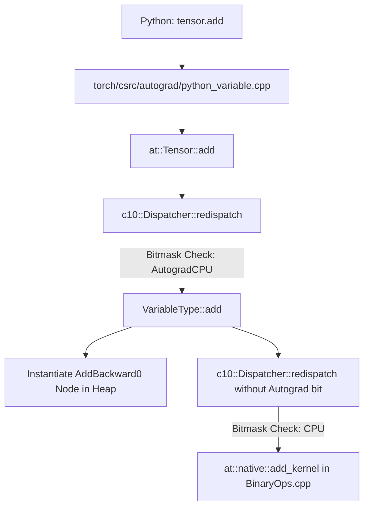

# ARIA Demo — PyTorch Operator Dispatch & Autograd Interception

## Overview
This demo illustrates how ARIA navigates the boundary between Python user-space code and the underlying C++ C10 Dispatcher and ATen kernel infrastructure in PyTorch.

---

## 1. Developer Question
> *"When a developer executes `z = x.add(y)` on two PyTorch tensors with gradient tracking enabled, how does execution flow from Python into C++, how does the C10 Dispatcher select the kernel, and where is the autograd backward node instantiated?"*

---

## 2. ARIA Structural Analysis Pipeline

```
Developer Question
        │
        ▼
[ARIA Query Engine]
        │
        ├─► 1. Binding Discovery: Locates pybind11 wrappers in torch/csrc/
        │
        ├─► 2. Dispatcher Architecture: Locates c10::Dispatcher & DispatchKeySet
        │
        ├─► 3. Autograd Layer Tracing: Maps VariableType autograd interception
        │
        └─► 4. Evidence Assembly: Validates C++ headers and Python AST definitions
```

---

## 3. Discovered Structural Evidence

### Relevant Files
- `torch/tensor.py`: Python top-level tensor interface.
- `torch/csrc/autograd/python_variable.cpp`: C++ pybind wrapper exposing ATen tensor methods.
- `c10/core/Dispatcher.h`: Central dynamic operator dispatcher.
- `c10/core/DispatchKeySet.h`: 64-bit bitmask managing dispatch keys (CPU, CUDA, Autograd).
- `aten/src/ATen/native/BinaryOps.cpp`: Native SIMD / C++ CPU kernel implementations.

### Discovered Symbols & AST Definitions
- `class Tensor` — [torch/tensor.py](file:///torch/tensor.py)
- `class Dispatcher` — [c10/core/Dispatcher.h](file:///c10/core/Dispatcher.h)
- `class DispatchKeySet` — [c10/core/DispatchKeySet.h](file:///c10/core/DispatchKeySet.h)
- `struct Node` — [torch/csrc/autograd/function.h](file:///torch/csrc/autograd/function.h)

---

## 4. Execution Call Chain



---

## 5. Evidence-Backed Architectural Answer

1. **Python to C++ Bridge:** The Python call `tensor.add(y)` invokes a C++ method registered via PyBind11 in `torch/csrc/autograd/python_variable.cpp`. This delegates to the ATen library function `at::Tensor::add`.
2. **C10 Dispatcher Lookup:** `at::Tensor::add` queries the central `c10::Dispatcher` (`c10/core/Dispatcher.h`). The Dispatcher inspects the tensor's thread-local `DispatchKeySet` (`c10/core/DispatchKeySet.h`).
3. **Autograd Interception:** Because `requires_grad=True`, the bit corresponding to `DispatchKey::Autograd` is active. The Dispatcher routes first to `VariableType::add`:
   - It instantiates an autograd graph node (`AddBackward0`, inheriting from `torch::autograd::Node`).
   - It links this node to the input tensors' history DAG.
4. **Kernel Dispatch:** The autograd layer then calls `redispatch()`, stripping the autograd key from the bitmask. The Dispatcher resolves the remaining device key (e.g. `DispatchKey::CPU`) and invokes the low-level SIMD kernel in `aten/src/ATen/native/BinaryOps.cpp`.

---

## 6. Static Analysis Boundary & Limitations
- **What ARIA Validates:** The layout of Python bindings, the structure of the C10 Dispatcher headers, and native C++ kernel source locations.
- **Where Static Analysis Stops:**
  1. *Bitmask Dispatching:* The actual selection of whether CPU, CUDA, MPS, or Autograd runs is determined at runtime by 64-bit integer bitwise operations on `DispatchKeySet`.
  2. *Ephemeral Autograd Graphs:* The backward graph is constructed dynamically in C++ heap memory during execution; it has no static representation in source files.
